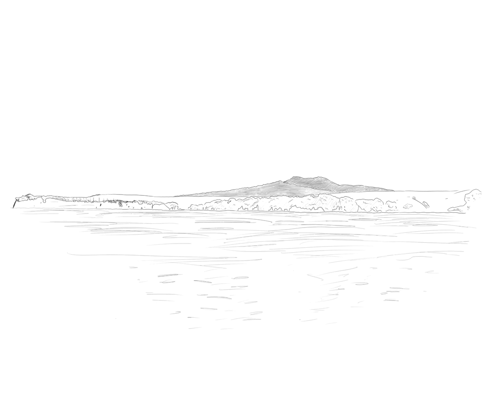
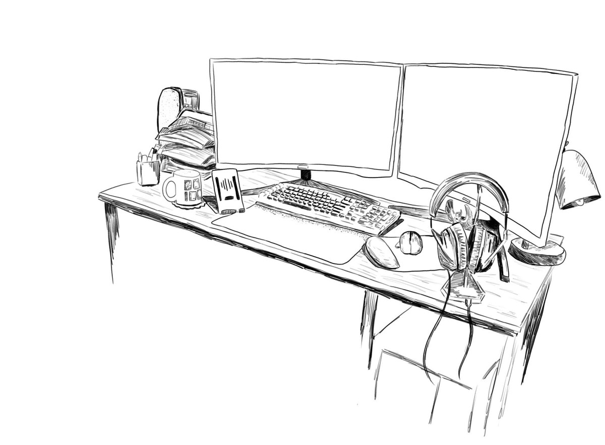
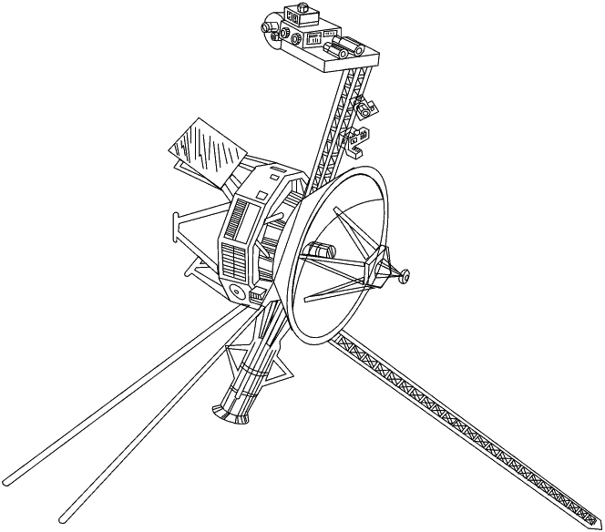
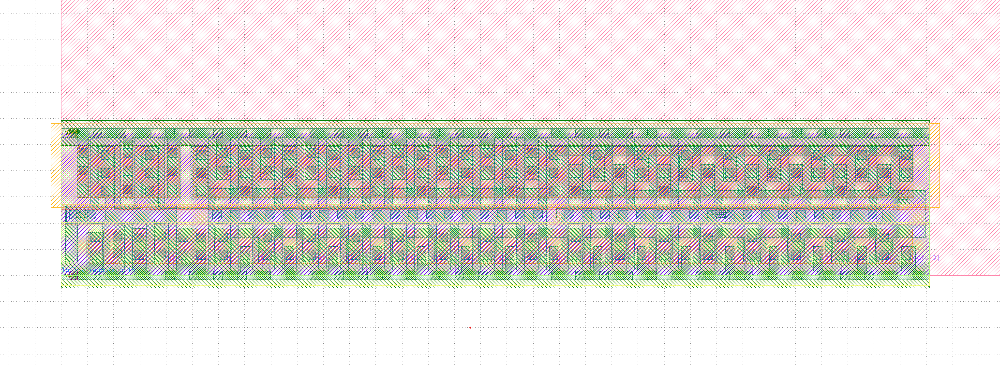
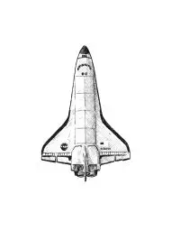
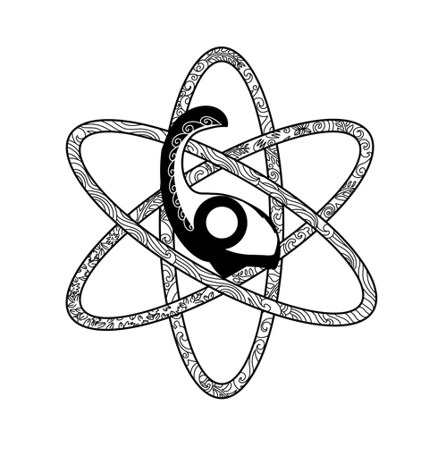

# G'day, Kia Ora

I'm Zane, from NZ. I like me a bevvy and a splash of assembler. I usually dabble with computers several years older than me and occasionally I produce something quite useful.

Everything is built from primary sources, original manuals, and the occasional declassified document.

The full list of projects, and the write ups explaining them, lives at [zanehambly.com](https://zanehambly.com). This page is the short version.

I like to be as transparent as possible in how I work. If you'd like to see my notes, assembly dumps and a mishmash of human and generated tests feel free to visit [bits and bobs](https://github.com/Zaneham/bits-and-bobs).

---

## Upstream Contributions

Everything I've sent upstream is [in one search](https://github.com/search?q=author%3AZaneham+is%3Apr+-user%3AZaneham&type=pullrequests&s=created&o=desc).

- **[OCaml](https://github.com/ocaml/ocaml/pulls?q=is%3Apr+author%3AZaneham)** - Native code compiler backend. Atomics across all five architectures, square root, fused multiply-add, rounding and bit counting as single instructions, and bulk operations on float arrays
- **[LLVM](https://github.com/llvm/llvm-project/pulls?q=is%3Apr+author%3AZaneham)** - X86 backend and MC layer, mostly the Intel syntax matcher and the encoder
- **[LFortran](https://github.com/lfortran/lfortran/pulls?q=is%3Apr+author%3AZaneham)** - Legacy F77 intrinsics and GPU offloading for `do concurrent`
- **[Solo5](https://github.com/Solo5/solo5/pulls?q=is%3Apr+author%3AZaneham)** - riscv64 support for the spt target
- **[z390](https://github.com/z390development/z390/pulls?q=is%3Apr+author%3AZaneham)** - Core contributor to the IBM mainframe assembler/emulator, including COBOL macros, VSAM enhancements, and NIST test suite work

---

## Key Projects

**[Takahe](https://github.com/Zaneham/Takahe)** - Open-source digital synthesis tool. SystemVerilog, VHDL and ABEL-HDL down to gate-level netlists, targeting four open PDKs (SKY130 130nm, IHP SG13G2, GF180MCU, ASAP7 7nm) and the 74LS series, where area is counted in packages rather than micrometres. Reads JEDEC fuse maps off old PLDs. Thirteen computing paradigms including ternary, quantum and probabilistic. Place and route through OpenROAD

**[Booth](https://github.com/Zaneham/Booth)** - Open-source GPU compiler. Takes CUDA, HIP and Triton and targets AMD (RDNA 2/3/4, CDNA3), NVIDIA PTX, Tenstorrent Tensix, or native x86-64/RV64 so GPU code runs on machines with no GPU. First CUDA compiled and running on Tenstorrent's non-SIMT RISC-V dataflow architecture. Fortran and OCaml frontends underway. Zero LLVM, own pipeline from preprocessor through to ELF emission. Binary is `kath`, after Kathleen Booth

**[Moa](https://github.com/Zaneham/Moa)** - Monte Carlo neutron transport. Neutrons are tracked one at a time through constructive solid geometry against ENDF/B-VII.1 cross sections, with resonance reconstruction and unresolved resonance probability tables. Validated on the Godiva, Jezebel and Flattop criticality benchmarks, and GPU-accelerated via Booth, so the kernel compiles with no NVCC anywhere near it and runs on an RTX 4060 Ti and an MI300X. Prebuilt binaries for Linux, Windows and macOS

**[Voyager FDS](https://github.com/Zaneham/voyager-fds-emulator)** - Emulator for the Voyager Flight Data Subsystem, the computer that's leaving the solar system. Built from documentation tracked down at Wichita State University, since the machine itself is 24 billion kilometres away and cannot be consulted. The same design has been synthesised to SKY130 silicon in 58 cells, so it runs as software and as a chip

**[Halmat](https://github.com/Zaneham/Halmat)** - A reconstructed specification of HALMAT, the intermediate language every line of Shuttle flight software passed through on its way to object code. Nobody documented it, so the reconstruction came from writing a PL/I F parser in OCaml and pointing it at 630 source files of a compiler last touched in the 1990s, written in a language from 1969, targeting hardware from 1964. The grammar is a hypothesis and Menhir is the interrogator, because every conflict the parser generator reports is the language telling you where its real edges are

---

Based in New Zealand, GMT+12/13

**zanehambly@gmail.com**

My profile picture for the next wee while is not me, I'm not nearly as handsome, it's Barry, 63. [knowyourmeme.com/memes/barry-63](https://knowyourmeme.com/memes/barry-63)

---

  
  
  
  

  
  
  
  

Some images from the files

